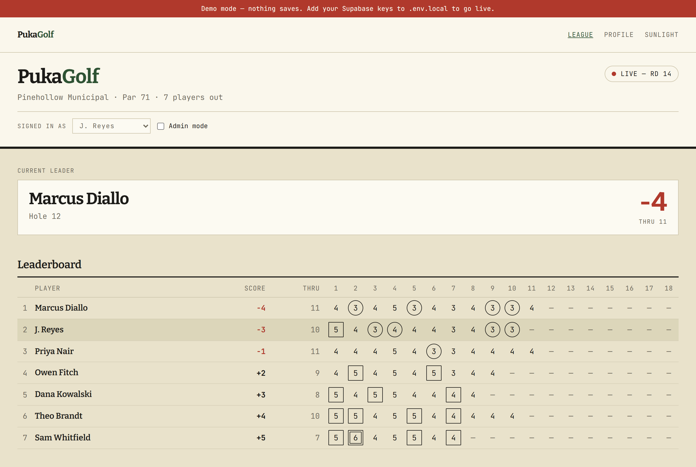
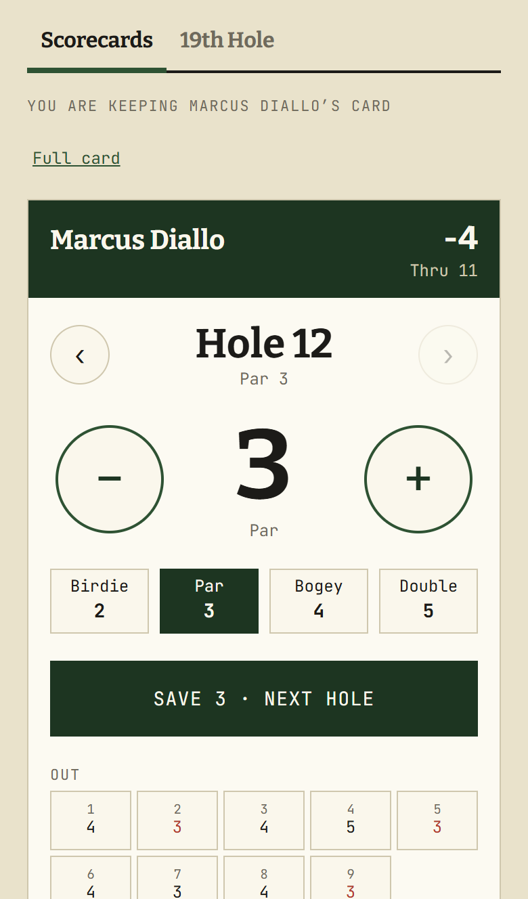

# PukaGolf

Live golf scoring for clubs and their leagues. An admin sets the week's tee
times and pairings; within each group the scoring rotates, so nobody enters
their own card. Scores appear on everyone's phone as they are tapped in.

**Live at [pukagolf.vercel.app](https://pukagolf.vercel.app)**

> Published for viewing as a portfolio. Some components are kept out of this
> repository — see [What isn't here](#what-isnt-here).

## Screenshots

All taken from the app's demo mode, which runs with no database behind it, so
the players and scores here are seeded fixtures rather than a real club's week.



_The league page. The leader card and the hole-by-hole board update as scores
are tapped in; [the whole page](docs/images/league-full.png) carries the
scorecards, standings, skins and the clubhouse feed below._

<table>
<tr>
<td width="46%"></td>
<td valign="top">

**Entering a card, on the phone it will actually be used on.** The scorer is
told whose card they are keeping — never their own. One hole at a time, with
the par-relative shortcuts next to the counter, because the alternative is
thumbing a number field in bright sun with a glove on. Saving moves to the
next hole; a tap with no signal is queued and marked as held.

</td>
</tr>
</table>


_The two ways in are deliberately separate: the league needs an account, a
one-off outing needs only its link._

## What it does

- **A week of league golf.** Tee times, groups, a rotating scorer within each
  group, a live leaderboard, skins, and a clubhouse feed. Scores sync between
  devices over Supabase realtime, and an optimistic local write is reconciled
  against the broadcast so a tap never feels slow.
- **Offline scoring.** A card entered with no signal is queued, marked as held,
  and sent as one batch when the phone comes back — because the far corner of
  a course usually has nothing.
- **Handicaps.** Rounds that qualify reach a player's record and drive a
  handicap index, with net and gross rankings side by side.
- **Eleven game formats, one system.** `src/lib/formats/` describes a game by
  five facts — the team sizes it can be played at, one ball or their own, how
  many count, what ranks them, and whether it needs an even number of sides —
  and everything downstream reads those instead of branching on a name. Team
  size is deliberately not part of a format, which is what turns nineteen named
  combinations into eleven specs and makes adding a twentieth one entry in a
  registry.
- **Outings and league events**, from the same table and the same registry,
  separated by who can get in: an outing is an unguessable share link scored by
  whoever holds it, names typed in and no accounts; a league event has an
  invited roster of members and results that reach their profiles.
- **Multiple clubs.** Members, join requests, staff roles, per-league rules and
  a club's own public page, with each club's data walled off from the others in
  the database rather than in the app.
- **Installable.** A PWA, so it goes on a phone's home screen.

## Stack

| | |
|---|---|
| **Framework** | Next.js 16 (App Router), React 19, TypeScript |
| **Styling** | Tailwind CSS 4 |
| **Backend** | Supabase — Postgres, row level security, realtime |
| **Tests** | Vitest (unit), Playwright (browser) |
| **Hosting** | Vercel |

Roughly 200 TypeScript modules, 61 migrations, 48 unit-test files and 20
browser suites.

## How the rules are enforced

Every rule that matters lives in the database, not in the app. Players can only
write the cards they have been assigned; admins are checked by
`security definer` functions that test the caller's role themselves, so a page
hiding a button is a courtesy and never the lock. Each migration in
`supabase/migrations/` opens with a comment saying what it protects and why.

`src/lib/formats/parity.test.ts` builds the same field through both storage
paths — a recurring league week and a one-off event — and asserts every format
scores identically from either. That test is the only thing stopping a scoring
rule from being written into one adapter instead of the shared code.

## Running it

```bash
npm install
cp .env.example .env.local   # then fill in your Supabase URL and anon key
npm run dev
```

```bash
npm test         # unit tests (Vitest)
npm run build    # production build
npm run test:e2e # browser tests (Playwright)
```

`npm run dev` works without credentials — the app starts in demo mode, with a
banner and seeded data, so you can click through the UI. `npm run build` does
need the two Supabase variables set, because the platform page is prerendered
with a real client. `npm test` needs nothing.

Applying the migrations to a fresh Supabase project also needs the league
owner set, which is not hardcoded here: see `.env.example` and
`supabase/seed/owner.local.sql.example`.

## What isn't here

A few things are deliberately kept out of the public repository. Each one
leaves a short note in place of itself, and nothing the app needs at runtime is
missing:

- **The security review** (`docs/README.md`) — it maps the live deployment's
  defences in enough detail to be useful to someone attacking them.
- **The tester agents' system prompts** (`.claude/agents/README.md`) — two AI
  agents that drive the browser as a player and as a club professional and
  write up what they find. The machinery they use is here; the personas are
  not.
- **Internal working notes** and the operational runbook.
- **Credentials and project identifiers**, which come from the environment.
  `.env.example` lists every variable and what it is for.

## License

Copyright (c) 2026 James Amalfitano. All rights reserved. Published for viewing
as a portfolio only; see [LICENSE](LICENSE).
